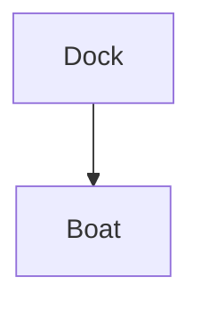

Synthetic CC0 fixture content. Written for the doc viewer tests.

This index links to a note in another folder: [[tools/ripgrep|the ripgrep note]], and to a heading elsewhere: [[guides/tides#Spring tides]].

## Block reference

The tide table is checked twice a day. ^tide-check

See [[guides/tides#^tide-check]] for the same idea in another note, and an [external link](https://example.com/harbour).

## Callouts

> [!note]- Collapsed callout
> This callout starts collapsed. It holds the nested one below.
>
> > [!warning]- Nested callout
> > Nested content that must stay hidden while the outer callout is collapsed.

> [!tip] Open callout
> Tips are visible by default.

## Maths

The inline formula $E = mc^2$ and a display formula:

$$
\int_0^1 x^2\,dx = \frac{1}{3}
$$

## Diagram

